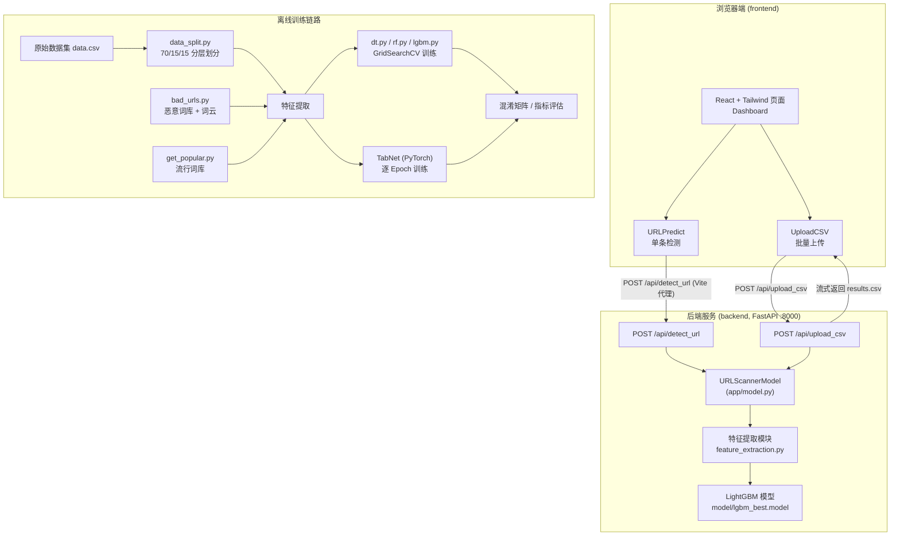
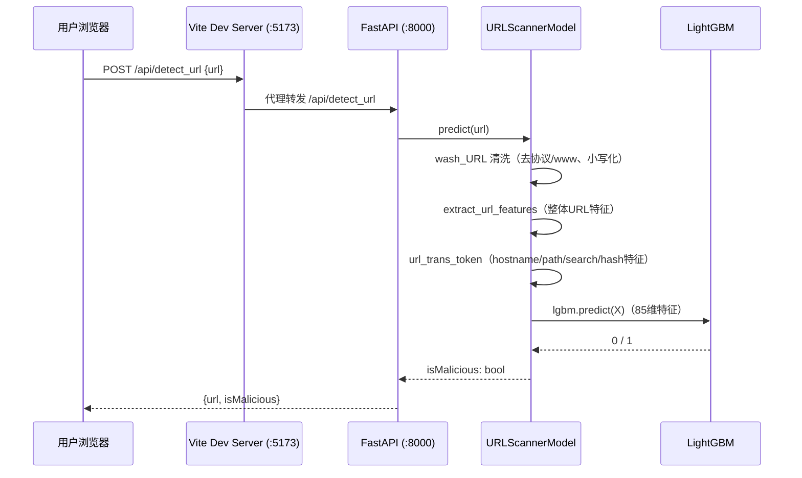

# LinkScanner — 基于机器学习的恶意 URL 检测系统

LinkScanner 是一个前后端分离的恶意链接（Malicious URL）检测系统。系统通过对 URL 字符串进行多维度特征工程（整体 URL、主机名、路径、查询参数、锚点），结合决策树、随机森林、LightGBM、TabNet 等多种机器学习 / 深度学习模型完成二分类（良性 `good` / 恶意 `bad`），并通过 FastAPI 提供在线推理服务，React 前端支持**单条 URL 实时检测**与 **CSV 文件批量检测并下载结果**。


***

## 目录


* [功能特性](#功能特性)

* [技术栈](#技术栈)

* [系统架构](#系统架构)

* [目录结构](#目录结构)

* [数据集说明](#数据集说明)

* [特征工程](#特征工程)

* [模型与评估](#模型与评估)

* [API 接口文档](#api-接口文档)

* [快速开始](#快速开始)

* [离线训练与检测流程](#离线训练与检测流程)

* [注意事项与已知问题](#注意事项与已知问题)


***

## 功能特性


* **单条 URL 检测**：输入任意 URL，实时返回 `Malicious`（恶意）/ `Safe`（安全）判定。

* **CSV 批量检测**：上传包含 `url` 列的 CSV 文件（自动兼容 UTF-8 / GBK 编码），服务端批量推理后流式返回 `results.csv` 供下载。

* **多维特征工程**：从 URL 中提取共 **85 维**结构化特征，涵盖字符统计、结构解析、信息熵、IP 识别、黑白词库命中、TLD 风险评分等。

* **多模型对比**：实现决策树、随机森林、LightGBM、TabNet 四类模型，支持网格搜索（GridSearchCV）与 Optuna 超参数优化。

* **集成投票**：离线脚本支持 DT + RF + LightGBM 三模型多数投票（Majority Voting）。

* **自动词库构建**：从恶意 URL 语料统计高频恶意词、从世界 Top 500 网站提取流行词，自动生成特征词库与词云图。

* **完整评估体系**：输出准确率（Accuracy）、精确率（Precision）、召回率（Recall）、F1、AUC、混淆矩阵及逐 Epoch 训练曲线。

* **自动接口文档**：FastAPI 原生提供 Swagger UI（`/docs`）。


***

## 技术栈

### 后端（在线服务）


| 类别       | 技术                   | 说明                                 |
| -------- | -------------------- | ---------------------------------- |
| Web 框架   | **FastAPI**          | 异步 API 框架，自动生成 OpenAPI 文档          |
| ASGI 服务器 | **Uvicorn**          | 开发 / 运行 FastAPI 应用                 |
| 数据校验     | **Pydantic**         | 请求 / 响应数据模型定义                      |
| 数据处理     | **Pandas / NumPy**   | DataFrame 特征拼接与批处理                 |
| 模型加载     | **Joblib**           | 加载 scikit-learn / LightGBM 序列化模型   |
| 文件上传     | **python-multipart** | 处理 CSV 文件上传（`multipart/form-data`） |

### 机器学习 / 深度学习（离线训练）


| 类别     | 技术                                                               |
| ------ | ---------------------------------------------------------------- |
| 传统机器学习 | **scikit-learn**（DecisionTree、RandomForest、GridSearchCV、metrics） |
| 梯度提升树  | **LightGBM**                                                     |
| 深度学习   | **PyTorch**、**PyTorch Frame**（TensorFrame）、自研 **TabNet** 表格注意力网络 |
| 超参数优化  | **Optuna**                                                       |
| 可视化    | **Matplotlib**、**Seaborn**、**WordCloud**（词云）                     |

> `backend/requirements.txt`
> 已包含项目
> **全部依赖**
> ，并按「在线服务依赖」与「模型训练与离线评估依赖」两部分分组、注明用途与已验证版本下限；仅部署在线服务时可只安装第一部分。

### 前端


| 类别    | 技术                                         |
| ----- | ------------------------------------------ |
| UI 框架 | **React 18**（函数组件 + Hooks）                 |
| 构建工具  | **Vite 5**（开发服务器 + 打包）                     |
| 样式方案  | **Tailwind CSS 3**（PostCSS / Autoprefixer） |
| 图标库   | **lucide-react**                           |
| 语言    | JavaScript（JSX）                            |


***

## 系统架构

### 整体架构图




### 请求处理时序（单条 URL 检测）





***

## 目录结构


```
mudsw/
├── backend/                         # 后端：机器学习 + FastAPI 服务
│   ├── app/                         # FastAPI 应用包
│   │   ├── main.py                  # 应用入口、路由、CORS、CSV 流式响应
│   │   ├── model.py                 # URLScannerModel：特征提取 + LightGBM 推理封装
│   │   ├── schemas.py               # Pydantic 请求/响应模型
│   │   ├── utils.py                 # CSV 解析（编码兼容）与结果格式化
│   │   └── __init__.py
│   ├── data/                        # 数据集目录
│   │   ├── data.csv                 # 原始全量数据（约 42 万条，url + label）
│   │   ├── bad_urls.csv             # 恶意 URL 原始语料
│   │   ├── badwords.txt             # 高频恶意词库（自动生成）
│   │   ├── popular_web.txt          # 流行网站词库（自动生成）
│   │   ├── World_Top_500.csv        # 世界 Top 500 网站
│   │   ├── bad_good_data/           # 按标签分离的数据及特征
│   │   ├── splited_data/            # 训练/测试/验证集（CSV + .pt + 特征文件）
│   │   └── test_data/               # 外部测试数据（如 fishtank.csv）
│   ├── model/                       # 已训练模型（joblib 序列化）
│   │   ├── dt_best.model            # 最优决策树
│   │   ├── rf_best.model            # 最优随机森林
│   │   └── lgbm_best.model          # 最优 LightGBM（线上服务使用）
│   ├── eval_indicators/             # TabNet 逐 epoch 指标（.pkl）
│   ├── optuna/                      # Optuna 优化历史 / Pareto 前沿图
│   ├── 3_confusion_matrix/          # DT / RF / LightGBM 混淆矩阵图
│   ├── TabNet_confusion_matrix/     # TabNet 测试集 / 验证集混淆矩阵
│   ├── feature_extraction.py        # 【核心】URL 清洗与 85 维特征提取
│   ├── bad_urls.py                  # 恶意词统计、词云生成、TLD 白名单
│   ├── get_popular.py               # 从 Top 500 网站提取流行词与词云
│   ├── data_split.py                # 70/15/15 分层划分数据集
│   ├── data_split_bad_good.py       # 按标签分离数据并统计特征均值差异
│   ├── dt.py                        # 决策树训练（GridSearchCV）
│   ├── rf.py                        # 随机森林训练（GridSearchCV）
│   ├── lgbm.py                      # LightGBM 训练（GridSearchCV）
│   ├── detect_single_url.py         # 命令行单条 URL 循环检测
│   ├── detect_csv_url.py            # 离线 CSV 批量检测（三模型投票）
│   ├── detect_validation_dataset.py # 验证集评估与混淆矩阵输出
│   ├── plot_curve.py                # 训练曲线（F1 等）平滑插值绘图
│   ├── look_pt.py                   # .pt 数据文件内容查看工具
│   └── requirements.txt             # Python 全量依赖（服务 + 训练，分组列出）
│
└── frontend/                        # 前端：React + Vite + Tailwind
    ├── index.html
    ├── package.json
    ├── vite.config.js               # Vite 配置（/api 代理到 :8000）
    ├── tailwind.config.js
    ├── postcss.config.js
    ├── public/
    └── src/
        ├── main.jsx                 # React 入口
        ├── App.jsx                  # 页面外壳
        ├── index.css                # Tailwind 全局样式
        └── components/
            ├── Dashboard.jsx        # 功能面板容器（组合两个模块）
            ├── URLPredict.jsx       # 单条 URL 检测
            └── UploadCSV.jsx        # CSV 批量上传与结果下载
```


***

## 数据集说明


| 文件                                | 规模（约）     | 说明                                        |
| --------------------------------- | --------- | ----------------------------------------- |
| `data/data.csv`                   | 420,464 条 | 全量标注数据，列为 `url,label`，标签取值 `good` / `bad` |
| `data/bad_urls.csv`               | 26,250 条  | 恶意 URL 原始语料，用于恶意词统计与词云                    |
| `splited_data/Training.csv`       | 294,324 条 | 训练集（70%），分层抽样                             |
| `splited_data/Test.csv`           | 63,070 条  | 测试集（15%）                                  |
| `splited_data/Validation.csv`     | 63,070 条  | 验证集（15%）                                  |
| `bad_good_data/bad_urls.csv`      | 75,643 条  | 分离后的恶意样本                                  |
| `bad_good_data/good_urls.csv`     | 344,821 条 | 分离后的良性样本                                  |
| `bad_good_data/good_urls_new.csv` | 75,643 条  | 与恶意样本等量的平衡良性样本                            |
| `data/World_Top_500.csv`          | 500 条     | 世界知名网站，用于提取流行词白名单                         |

数据划分策略（`data_split.py`）：


1. 先按 **70% / 30%** 划分训练集与临时集；

2. 临时集再按 **50% / 50%** 划分为测试集与验证集（即整体 70% / 15% / 15%）；

3. 全程使用 `stratify` 分层抽样（`random_state=42`），保证各集合恶意样本比例一致。


***

## 特征工程

特征定义集中在 `feature_extraction.py` 的 `colnames`（共 87 列 = `url` + `label` + **85 维特征**），分为五组：

### 1. 整体 URL 特征（39 维）


* `URL_len`：URL 总长度；

* `letter_ratio` / `dig_ratio`：字母 / 数字占比；

* `special_ch` / `special_ch_kind`：特殊字符数量与种类数；

* `URL_depth`：斜杠 `/` 数量（路径深度）；`URL_point`：点号 `.` 数量；

* `at_flag`：是否包含 `@` 符号（钓鱼链接常用混淆手段）；

* `TLD_id`：顶级域名风险评分 —— 命中常见 TLD 白名单则取其索引（值越小越常见），不常见为 `500`，TLD 含数字为 `1000`；

* `badword_n` / `popular_n`：恶意词库 / 流行词库命中次数；

* `exe_flag`：`.exe`、`.php` 等危险扩展名出现次数；

* `http_flag`：URL 中非开头位置出现 `http` / `www` 的次数（疑似嵌套链接）；

* `URL_a` \~ `URL_z`：26 个英文字母各自出现次数。

### 2. 主机名 Hostname 特征（35 维）


* `hostname_a` \~ `hostname_z`：主机名中 26 个字母计数；

* `hostname_token_n`：分隔符切分后的 token 数量；

* `hostname_len` / `hostname_std`：主机名长度与 token 长度标准差；

* `hostname_letter_ratio` / `hostname_dig_ratio`：字母 / 数字占比；

* `hostname_entropy`：主机名字符**信息熵**（衡量随机性，随机域名 DGA 熵值偏高）；

* `hostname_point_n`：点号数量；`hostname_ch_n`：其他特殊字符数量；

* `hostname_is_ip`：主机名是否为 IP 地址（含字母则判定为非 IP）。

### 3. 路径 Pathname 特征（6 维）

`pathname_token_n`、`pathname_len`、`pathname_depth`、`pathname_longest_token`（最长 token）、`pathname_ch_kind`（特殊字符种类）、`pathname_std`。

### 4. 查询参数 Search 特征（4 维）

`search_token_n`、`search_len`、`search_std`、`search_and_n`（`&` 参数个数）。

### 5. 锚点 Hash 特征（1 维）

`hash_token_n`：锚点部分 token 数量。

### URL 预处理（`wash_URL`）


* 全部转小写；

* 去除 `http://`、`https://`、`www` 及其他协议（如 `ftp://`）前缀；

* URL 解码（`urllib.parse.unquote`）；

* 不含 `/` 的 URL 自动补 `/`，保证结构解析一致。

### 词库自动构建


* **恶意词库** `data/badwords.txt`：`bad_urls.py` 将恶意 URL 按特殊字符切分、剔除常见 TLD，统计出现频次 > 10 的词生成，并绘制恶意词云（`badword_cloud.png`）。

* **流行词库** `data/popular_web.txt`：`get_popular.py` 从世界 Top 500 网站中剔除 TLD 后提取高频词生成，并绘制流行词云（`popular_cloud.png`）。


***

## 模型与评估

### 模型清单


| 模型                 | 脚本                                  | 说明                                                                             |
| ------------------ | ----------------------------------- | ------------------------------------------------------------------------------ |
| 决策树 Decision Tree  | `dt.py`                             | 调优 `criterion`、`max_depth`、`min_samples_split/leaf`、`max_features`             |
| 随机森林 Random Forest | `rf.py`                             | 调优 `n_estimators`、`max_depth`、`min_samples_*`、`max_features`                   |
| LightGBM           | `lgbm.py`                           | 调优 `learning_rate`、`n_estimators`、`max_depth`、`num_leaves`、`min_child_samples` |
| TabNet             | PyTorch + torch-frame（训练脚本未包含在当前仓库） | 表格数据注意力网络，逐 Epoch 训练并记录指标                                                      |

### 训练与调优机制


* 传统模型统一使用 **GridSearchCV**：5 折交叉验证（`cv=5`），多指标评分（Accuracy / Precision / Recall / F1），并以 **Precision 为 refit 目标**选出最优模型（降低误报率）；

* 全部设置 `class_weight='balanced'` 处理类别不平衡；

* 另使用 **Optuna** 进行超参数搜索，产物为 `optuna/optimization_history1.png`（优化历史）与 `optimization_pareto_front1.png`（Pareto 前沿）；

* 训练完成的模型通过 Joblib 序列化保存至 `model/` 目录。

### 评估指标与产物


* 指标：Accuracy、Precision、Recall、F1、AUC、混淆矩阵；

* 混淆矩阵：`3_confusion_matrix/`（DT / RF / LightGBM 的验证集与测试集）、`TabNet_confusion_matrix/`；

* TabNet 逐 Epoch 指标保存在 `eval_indicators/*.pkl`（train /test/validation 各 7 项指标）；

* `plot_curve.py` 使用三次样条插值绘制平滑的 Train / Test / Validation 指标曲线；

* `detect_csv_url.py` 提供 **DT + RF + LightGBM 三模型多数投票**（≥2 票判为恶意）的离线批量检测。

> **线上推理服务（**
> `app/model.py`
> **）当前仅加载并使用 LightGBM 模型**
> （
> `model/lgbm_best.model`
> ）。


***

## API 接口文档

服务启动后访问交互式文档：[http://localhost:8000/docs](http://localhost:8000/docs)

### 1. 单条 URL 检测


* **路径**：`POST /api/detect_url`

* **Content-Type**：`application/json`

* **请求体**：


```
{
  "url": "http://example.com/path"
}
```


* **响应体**（`URLResponse`）：


```
{
  "url": "http://example.com/path",
  "isMalicious": false
}
```

### 2. CSV 批量上传检测


* **路径**：`POST /api/upload_csv`

* **Content-Type**：`multipart/form-data`

* **表单字段**：`file` —— 仅支持 `.csv`，且文件中必须包含 `url` 列（支持 UTF-8 / GBK 编码，服务端自动识别）。

* **响应**：`text/csv` 文件流，浏览器自动下载为 `results.csv`，格式如下：


```
URL,Malicious
http://example.com/,No
http://evil.example/,Yes
```

### 数据模型（`app/schemas.py`）


| 模型            | 字段                             |
| ------------- | ------------------------------ |
| `URLRequest`  | `url: str`                     |
| `URLResponse` | `url: str`、`isMalicious: bool` |
| `CSVResult`   | `url: str`、`isMalicious: bool` |
| `CSVResponse` | `results: List[CSVResult]`     |


***

## 快速开始

### 环境要求


* Python 3.10+

* Node.js 16+（推荐 18+）与 npm

* Windows / Linux /macOS 均可

### 1. 启动后端服务


```
cd backend

# （推荐）创建虚拟环境
python -m venv .venv
# Windows
.venv\Scripts\activate
# Linux / macOS
source .venv/bin/activate

# 安装依赖（requirements.txt 含服务与训练全量依赖；
# 仅部署服务可只安装该文件“一、在线服务依赖”部分）
pip install -r requirements.txt

# 在 backend 目录下启动服务（默认 8000 端口）
uvicorn app.main:app --reload
```

验证：


* API 服务：[http://localhost:8000](http://localhost:8000)

* Swagger 文档：[http://localhost:8000/docs](http://localhost:8000/docs)

### 2. 启动前端服务


```
cd frontend

# 安装依赖
npm install

# 启动开发服务器（默认 http://localhost:5173）
npm run dev
```

浏览器打开 [http://localhost:5173](http://localhost:5173) 即可使用：


* 「URL 单条预测」：输入链接点击 Analyze URL；

* 「批量 CSV 上传预测」：选择含 `url` 列的 CSV，检测完成后自动下载 `results.csv`。

### 3. 前端生产构建（可选）


```
cd frontend
npm run build      # 产物输出到 dist/
npm run preview    # 本地预览构建产物
```

> 开发模式下，Vite 会将
> `/api`
> 请求代理到
> `http://localhost:8008`
> （见
> `vite.config.js`
> ），因此请先启动后端。


***

## 离线训练与检测流程

在 `backend/` 目录下按以下顺序执行（所有脚本均使用相对路径，**必须在&#x20;**`backend/`**&#x20;目录内运行**）：


```
# 1. 构建词库（恶意词 + 流行词）与词云
python bad_urls.py
python get_popular.py

# 2. 划分训练 / 测试 / 验证集（70 / 15 / 15）
python data_split.py

# 3. 提取特征（生成 Training/Test/Validation_features.csv 与 .pt 文件）
python feature_extraction.py

# 4. 训练模型（按需执行）
python dt.py
python rf.py
python lgbm.py

# 5. 验证集评估与混淆矩阵
python detect_validation_dataset.py

# 6. 命令行单条 URL 循环检测（输入 exit 退出）
python detect_single_url.py

# 7. 离线 CSV 批量检测（三模型投票，输出 detected_results.csv）
python detect_csv_url.py

# 8. 绘制训练曲线
python plot_curve.py
```

全量依赖（含训练 / 评估）已在 `requirements.txt` 中分组列出，直接安装即可：


```
pip install -r requirements.txt
```

> 复现 TabNet 需额外安装
> `torch-frame`
> （仓库未包含 TabNet 训练脚本）；GPU / CUDA 版 PyTorch 的安装方式见
> `requirements.txt`
> 末尾备注。


***

## 注意事项与已知问题


1. **工作目录依赖**：`app/model.py` 使用相对路径 `model/lgbm_best.model` 加载模型，`feature_extraction.py` 使用相对路径读取 `data/` 词库，必须在 `backend/` 目录下启动 uvicorn，否则会报文件找不到。

2. **Joblib 模型的运行库依赖**：模型经 Joblib 序列化，加载时环境中需安装对应模型库。在线服务加载 LightGBM 模型，`requirements.txt` 第一部分已包含 `torch`（因 `app/model.py` 首行 `import torch`）、`joblib`、`pandas`、`numpy`；训练与评估所需的 scikit-learn、LightGBM、Matplotlib 等列于第二部分。

3. **单条检测会产生临时文件**：`predict()` 流程中会在 `backend/` 下写入 `detect_single_muti.csv` 作为中间文件，属于历史实现，部署时可改为内存中直接构造特征。

4. **CORS 全开放**：当前配置 `allow_origins=["*"]`，仅适合本地开发 / 演示，生产环境应收紧为指定前端域名。

5. **前端地址不统一**：`URLPredict.jsx` 通过相对路径 `/api` 调用（依赖 Vite 代理），而 `UploadCSV.jsx` 中硬编码了 `http://localhost:8000`，生产部署时需统一为同源或配置环境变量。

6. **TabNet 训练脚本缺失**：仓库中保留了 TabNet 的推理代码（`detect_single_url.py` 注释部分）、评估指标与混淆矩阵，但训练脚本（如 `TabNet_model.py`）与模型权重未包含在当前目录中。

7. **历史路径残留**：部分离线脚本引用了 `classifier_model/`、`new_model/` 等旧模型目录，而当前模型实际位于 `model/`，运行这些脚本前需同步修改路径。